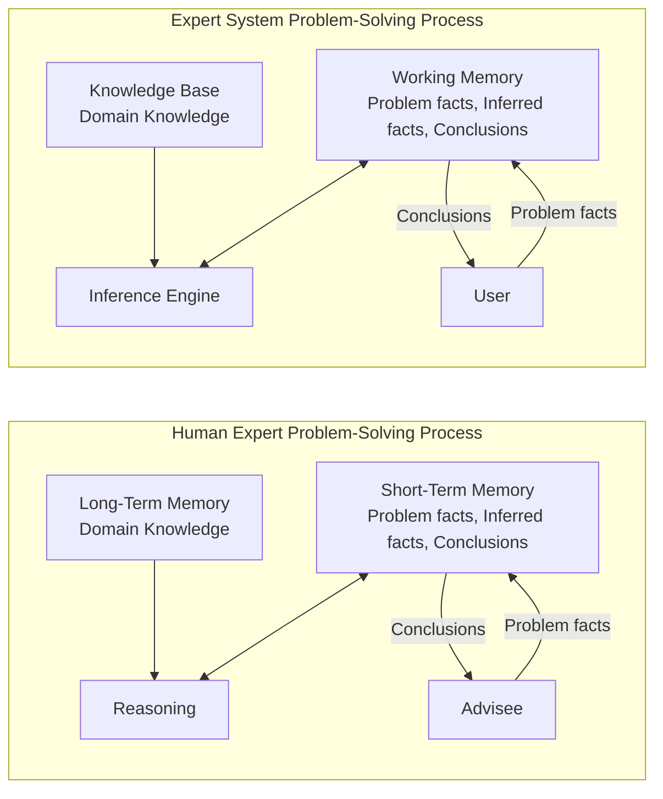
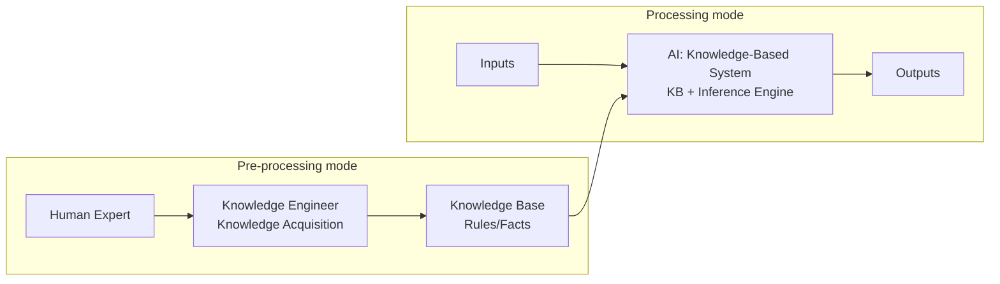
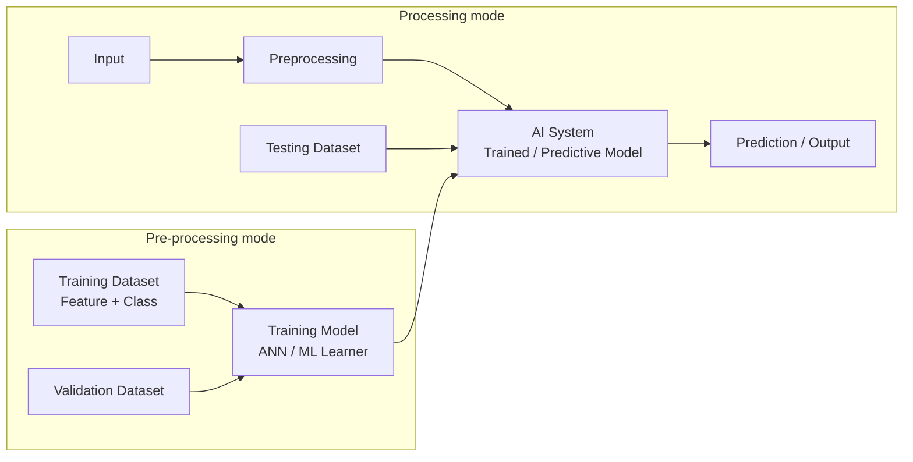

# เฉลย CPE310 Artificial Intelligence — Final Exam (full_Ex)

> เฉลยนี้เรียบเรียงจากสไลด์ในโฟลเดอร์ `Lec` (BBB_of_AI_Knowledge, AI_1, AI2025, AI_DataEngineering_2025, AI_ANN_2026, AI_ES_DigitalPlatform)
> นิยามที่เป็นภาษาอังกฤษยกมาจากสไลด์ของอาจารย์โดยตรง ตอนตอบควรเขียนให้ตรงกับคำในสไลด์
> 📍 = ที่มา (ชื่อไฟล์ใน `Lec/` + **หน้า PDF**) เปิดไฟล์แล้วกระโดดไปหน้านั้นได้เลย
> ไฟล์ที่อ้าง: `BBB_of_AI_Knowledge-…pdf` · `AI_1-…pdf` · `AI2025-…pdf` · `AI_DataEngineering_2025-…pdf` · `AI_ANN_2026-…pdf`

---

## ข้อ 1) Definition (2%)

📍 BBB_of_AI_Knowledge หน้า 1–2 (นิยามทุกตัว) · AI_1 หน้า 4–5 (General / Engineering Definition) และหน้า 19 (Expert System) · AI2025 หน้า 4–6, 24 (CI, BI, Swarm Intelligence) · AI_ANN_2026 หน้า 9–11 (ANN)

| ศาสตร์ | นิยาม (ตามสไลด์ BBB of AI Knowledge) |
|---|---|
| **Artificial Intelligence (AI)** | *AI is a field of study that seeks to explain and emulate human intelligent behaviors in terms of computational processes.*  AI เป็นศาสตร์ที่ศึกษาค้นคว้าเพื่ออธิบายและเลียนแบบพฤติกรรมความชาญฉลาดของมนุษย์ ในรูปของกระบวนการคำนวณทางคอมพิวเตอร์  (Engineering Definition: *AI is about generating representations and procedures that autonomously solve problems heretofore solved by humans.*) |
| **Computational Intelligence (CI)** | *CI is a field of study that seeks to explain and emulate human intelligent behaviors **and natural intelligent behaviors** in terms of computational processes.*  CI เป็นศาสตร์ที่อธิบายและเลียนแบบพฤติกรรมความชาญฉลาดของมนุษย์ **และของธรรมชาติ** (เช่น วิวัฒนาการ ฝูงมด ฝูงผึ้ง ระบบภูมิคุ้มกัน การอบเหนียวโลหะ) ในรูปของกระบวนการคำนวณ ครอบคลุม AI + Biological Intelligence (GA, Evolution Computation) + Swarm Intelligence (ACO, PSO, ABC, AIS) + Physical Intelligence (Simulated Annealing) |
| **Expert Systems** | ศาสตร์ย่อยของ AI ที่เน้นเลียนแบบความชาญฉลาดของมนุษย์ในเรื่อง **การแก้ปัญหา (Problem Solving)**  *A computer program designed to model the problem-solving ability of a human expert.* มีองค์ประกอบหลักคือ Knowledge Base + Inference Engine (+ Working Memory, User Interface, Explanation Facility) |
| **Fuzzy Logic** | ศาสตร์ย่อยของ AI ที่เน้นเลียนแบบความชาญฉลาดของมนุษย์ในเรื่อง **การตัดสินใจ (Decision Making)** ภายใต้ข้อมูลที่คลุมเครือ/ไม่แน่นอน โดยใช้ค่าความเป็นสมาชิก (membership grade) ในช่วง [0, 1] แทนค่าจริง/เท็จ (Zadeh, 1965) |
| **Artificial Neural Network (ANN)** | ศาสตร์ย่อยของ AI และ ML ที่เน้นเลียนแบบความชาญฉลาดของมนุษย์ในเรื่อง **การเรียนรู้ (Learning)**  *ANN are computing systems vaguely inspired by the biological neural networks that constitute animal brains. Such systems "learn" to perform tasks by considering examples, generally without being programmed with task-specific rules.* ประกอบด้วย neuron (node) เชื่อมกันด้วย edge ที่มี weight ซึ่งปรับค่าระหว่างการเรียนรู้ |
| **Natural Language Processing (NLP)** | ศาสตร์ย่อยของ AI ที่เน้นเลียนแบบความชาญฉลาดของมนุษย์ในเรื่อง **การเข้าใจและสื่อสารภาษามนุษย์ (Human Language Understanding & Communication)** เช่น Machine Translation, Chatbot, Speech Understanding |

---

## ข้อ 2) Human Problem Solving เทียบกับ Expert System Problem Solving (3%)

📍 AI_1 หน้า 29 (Human Expert Problem-Solving Process), หน้า 30 (Knowledge-Based System Problem-Solving Process), หน้า 31–37 (KB, WM, Inference Engine, Explanation Facility), หน้า 40–41 (Characteristics / เทียบกับ Conventional Programs)

| Human Expert | Expert System | หน้าที่ |
|---|---|---|
| Long-Term Memory | **Knowledge Base** | เก็บ Domain Knowledge (ความรู้เฉพาะด้าน เช่น rules) |
| Short-Term Memory | **Working Memory / Blackboard** | เก็บข้อเท็จจริงของปัญหาที่กำลังแก้ ข้อเท็จจริงที่อนุมานได้ และข้อสรุป |
| Reasoning | **Inference Engine** | นำข้อเท็จจริงมาจับคู่กับความรู้ เพื่ออนุมานข้อเท็จจริงใหม่จนได้ข้อสรุป |
| Advisee | **User** | ผู้ให้ข้อเท็จจริงของปัญหาและรับข้อสรุป |

**สรุปการทำงาน**
- มนุษย์: รับข้อเท็จจริงจากผู้ขอคำปรึกษา → เก็บไว้ในความจำระยะสั้น → ใช้เหตุผลร่วมกับความรู้ในความจำระยะยาว → ได้ข้อเท็จจริงใหม่วนซ้ำจนได้ข้อสรุป → ให้คำแนะนำ
- Expert System: ผู้ใช้ป้อนข้อเท็จจริงลง Working Memory → Inference Engine จับคู่ (match) กับ rule ใน Knowledge Base → rule ที่ตรงจะถูก fire และเพิ่มข้อสรุปลง WM → วนซ้ำจนไม่มี rule ให้ fire หรือถึง goal → แสดงข้อสรุป และใช้ Explanation Facility อธิบาย HOW/WHY ได้

**ความเหมือน:** โครงสร้างเหมือนกันแบบ 1:1 คือแยกความรู้ (ระยะยาว) ออกจากข้อมูลของปัญหาที่กำลังแก้ (ระยะสั้น) และมีตัวประมวลผลเหตุผลอยู่ตรงกลาง
**ความต่าง:** Expert System แยก Knowledge ออกจาก Control อย่างชัดเจน, ทำงานได้ตลอดเวลาทุกที่, ไม่เหนื่อย/ไม่ลืม, อธิบายเหตุผลได้เป็นขั้นตอน แต่ใช้ได้เฉพาะโดเมนแคบ ไม่มี common sense ไม่เรียนรู้เองถ้าไม่ปรับ KB และผิดพลาดได้ถ้าความรู้ใน KB ผิด ส่วนมนุษย์ยืดหยุ่น สร้างสรรค์ และปรับตัวกับสถานการณ์ใหม่ได้ดีกว่า

---

## ข้อ 3) ออกแบบ AI System แบบ Knowledge Engineering เทียบกับ Data Engineering (3%)

📍 AI2025 หน้า 8 และ AI_ANN_2026 หน้า 2 (AI System Design) · AI_ANN_2026 หน้า 4 (Design: Knowledge Engineering), หน้า 5 (Design: Data Engineering), หน้า 6 (Architecture of ML/ANN System) · AI_1 หน้า 16 (Knowledge Engineering process), หน้า 44–46 (Domain Expert / Knowledge Engineer) · AI_DataEngineering_2025 หน้า 4 (Data Science team 3 roles), หน้า 6 (ขั้นตอน Data → Model → Deployment), หน้า 14 (Architecture of ML System), หน้า 52+ (Phases of Data Engineering)

**Knowledge Engineering:** ใช้ Domain Knowledge จาก Human Expert มาพัฒนาเป็น Intelligent System เช่น Expert System, Fuzzy Logic Control System

ขั้นตอน (Knowledge Engineering Process): Problem Assessment (Requirements) → Knowledge Acquisition (Domain Knowledge) → System Design (System Architecture) → System Development (Prototype) → Testing (Evaluation) → Documentation (System Product) → Maintenance พร้อมวนกลับเพื่อ Reformulations / Explorations / Refinements

**Data Engineering:** ใช้ Data จาก Real World มา Feed สอนให้ Model เรียนรู้ (Training) เช่น Machine Learning, ANN, Deep Learning, LLM

ขั้นตอน (Data pipeline): ศึกษา goal/ตั้งคำถาม → หาและนำเข้าข้อมูล (IDS) → เตรียมข้อมูล (ETL, Data Cleansing, EDA) → เก็บใน Analytic Data Store → สร้าง/ปรับ/ประเมิน Model (train/validate/test) → Deployment → Visualization & Reporting / Documentation

| ประเด็น | Knowledge Engineering | Data Engineering |
|---|---|---|
| แหล่งความฉลาด | ความรู้และประสบการณ์ของผู้เชี่ยวชาญ (heuristic) | รูปแบบที่ซ่อนอยู่ในข้อมูลจำนวนมาก |
| ผู้มีบทบาทหลัก | Domain Expert, Knowledge Engineer, End-user | Data Engineer, Data Scientist, Business Expert |
| ขั้นตอนสำคัญ | Knowledge Acquisition → Knowledge Representation (rules, frame, semantic net) | Data collection/cleansing → Feature → Training/Validation/Testing |
| Pre-processing mode | สร้าง Knowledge Base | Train Model |
| Processing mode | Inference Engine อนุมาน (forward/backward chaining) | Model ทำนาย (prediction/classification) |
| อธิบายผล | อธิบายได้ (HOW/WHY) โปร่งใส | มักเป็น black box อธิบายยาก |
| เหมาะกับ | งานที่มีผู้เชี่ยวชาญ กฎชัดเจน ข้อมูลน้อย เช่น วินิจฉัย ให้คำปรึกษา | งานที่มีข้อมูลมาก กฎเขียนออกมาตรงๆ ไม่ได้ เช่น จดจำภาพ เสียง ทำนาย |

**เหมือนกัน:** ทั้งสองแบบเป็นกระบวนการทางวิศวกรรมแบบวนซ้ำ (iterative) แบ่งเป็น pre-processing (สร้างความรู้/โมเดล) กับ processing (ใช้งานจริง) มีเป้าหมายเดียวกันคือเลียนแบบความชาญฉลาดของมนุษย์ และต้องทดสอบ ประเมินผล และบำรุงรักษาเหมือนกัน ถ้าใช้ทั้งสองแบบร่วมกันจะเรียกว่า Hybrid AI System

---

## ข้อ 4) Model และ Dataset (8%)

Model: $y = w_1x_1 + w_2x_2 + b$ (perceptron แบบ Two Inputs, One Bias, One Output คือ *"Hyperplane in 3 dimensions"*)

| $x_1$ | $x_2$ | $y$ |
|---|---|---|
| 1 | 1 | 2 |
| 2 | 3 | 4 |
| 4 | 2 | 6 |

📍 โจทย์ข้อนี้ตรงกับ AI_ANN_2026 หน้า 73–85 แทบทุกตัวเลข (Two Inputs – One Bias – One Output, ข้อมูลชุดเดียวกัน)

### 4.1 จะทำให้ Model นี้เป็น AI Model ที่ชาญฉลาดได้อย่างไร มีเงื่อนไขและขอบเขตหรือไม่

📍 AI_ANN_2026 หน้า 6 (Supervised Learning: Training/Testing/Validation Dataset), หน้า 43–54 (เลือก w แล้ววัด error: "Which one is the best?", MSE, "Perceptron try to find the weight that minimize error function"), หน้า 19–21 (XOR / Multilayer perceptron = ข้อจำกัดของ linear model) · AI_DataEngineering_2025 หน้า 15 (Types of ML) และสไลด์ Training Set / Test Set (overfitting)

**ทำให้ฉลาดได้โดยการเรียนรู้ (Learning) แบบ Supervised Learning ตามแนวทาง Data Engineering**
1. ตอนเริ่มต้น Model เป็นแค่สมการที่ยังไม่รู้ค่า $w_1, w_2, b$ จึงยังไม่ฉลาด
2. นำ Dataset ที่มีคำตอบกำกับ (labeled data: feature $x_1, x_2$ และ target $y$) มา Train
3. กำหนดตัววัดความผิดพลาด (Error / Loss function) คือ Mean Square Error $MSE = \frac{1}{n}\sum (Y_i - \hat{Y}_i)^2$
4. ปรับค่า weight และ bias ให้ MSE ต่ำที่สุด (perceptron tries to find the weight that minimizes the error function) ด้วยการหาอนุพันธ์ย่อยแล้วให้เท่ากับ 0 หรือใช้ Gradient Descent
5. ทดสอบกับ Testing/Validation Dataset แล้วนำ Trained Model ไปใช้ทำนาย $y$ ของ input ใหม่ (Prediction) ตอนนี้ Model จึงกลายเป็น AI Model ที่ "ฉลาด" คือตอบคำถามที่ไม่เคยเห็นได้จากรูปแบบที่เรียนรู้มา

**ความฉลาดนี้มีเงื่อนไขและขอบเขต**
- **ขึ้นกับข้อมูล:** ฉลาดได้เท่าที่ข้อมูลสอน ถ้าข้อมูลผิด ผลลัพธ์ก็ผิด (garbage in, garbage out) ข้อมูลต้องมากพอ ถูกต้อง และเป็นตัวแทนของปัญหาจริง
- **ขึ้นกับรูปแบบของ Model:** สมการนี้เป็นเชิงเส้น (linear/hyperplane) จึงฉลาดได้เฉพาะปัญหาที่ความสัมพันธ์เป็นเชิงเส้น ถ้าเป็น non-linear (เช่น XOR) ต้องเพิ่ม activation function หรือ hidden layer (MLP/Deep Learning)
- **ขอบเขตของข้อมูล (Domain):** ทำนายได้ดีในช่วงข้อมูลที่เคยเรียน (interpolation) แต่ถ้า input อยู่ไกลจากช่วงที่ train อาจผิดได้ (extrapolation)
- **Overfitting:** ที่นี่มี 3 ข้อมูลและ 3 ตัวแปร จึงได้ perfect fit (MSE = 0) แต่ไม่ได้รับประกันว่าจะ generalize ได้ดี ต้องทดสอบด้วย Test set ที่ไม่ซ้ำกับ Training set
- **ฉลาดเฉพาะงาน (Narrow AI / ANI):** ทำได้เฉพาะงานที่ train มา ไม่ใช่ General AI

### 4.2 $w_1, w_2, b$ เกี่ยวข้องหรือไม่ และหาค่าที่ทำให้ฉลาดที่สุดด้วย MSE

**เกี่ยวข้องโดยตรง** เพราะ $w_1, w_2$ (weights) และ $b$ (bias) เป็น "ความรู้" ที่ Model ได้จากการเรียนรู้ การทำให้ Model ฉลาดที่สุดก็คือการหาค่า $w_1, w_2, b$ ที่ทำให้ MSE น้อยที่สุด

**ขั้นที่ 1: เขียน Error function** 📍 AI_ANN_2026 หน้า 49 (สูตร MSE), หน้า 73 (Model สองอินพุต), หน้า 74 (New Error function)

$$MSE = \frac{1}{n}\sum_{i=1}^{n}(y_i - w_1x_{1i} - w_2x_{2i} - b)^2$$

**ขั้นที่ 2: มี 3 ตัวแปร จึงต้องหา partial derivative 3 ตัว แล้วให้เท่ากับ 0** (จุดต่ำสุดของ MSE คือจุดที่ slope = 0)
📍 AI_ANN_2026 หน้า 56 ("How to find the minimum point? Take the first derivative, derivative = 0"), หน้า 61 ("With 2 variables, we need Partial Derivatives"), หน้า 74 ("We need to take 3 partial derivatives"), หน้า 75 (∂MSE/∂w₁), หน้า 76 (∂MSE/∂w₂ "And third equation"), หน้า 77 (สรุปทั้ง 3 สมการรวม ∂MSE/∂b)

$$\frac{\partial MSE}{\partial w_1} = \frac{2}{n}\Big(w_1\sum x_{1i}^2 + w_2\sum x_{1i}x_{2i} + b\sum x_{1i} - \sum x_{1i}y_i\Big)$$

$$\frac{\partial MSE}{\partial w_2} = \frac{2}{n}\Big(w_1\sum x_{1i}x_{2i} + w_2\sum x_{2i}^2 + b\sum x_{2i} - \sum x_{2i}y_i\Big)$$

$$\frac{\partial MSE}{\partial b} = \frac{2}{n}\Big(w_1\sum x_{1i} + w_2\sum x_{2i} + nb - \sum y_i\Big)$$

ที่มาของสูตร (chain rule) ยกตัวอย่าง $w_1$ ตาม 📍 **AI_ANN_2026 หน้า 75** (แบบหนึ่งอินพุตอยู่ที่หน้า 68–69):

$$\frac{\partial MSE}{\partial w_1} = \frac{1}{n}\sum \frac{\partial}{\partial w_1}(y_i - w_1x_{1i} - w_2x_{2i} - b)^2 = \frac{1}{n}\sum 2(y_i - w_1x_{1i} - w_2x_{2i} - b)(-x_{1i})$$
$$= \frac{2}{n}\sum (w_1x_{1i}^2 + w_2x_{1i}x_{2i} + bx_{1i} - x_{1i}y_i)$$

$w_2$ ทำแบบเดียวกันแต่คูณด้วย $(-x_{2i})$ (หน้า 76) ส่วน $b$ คูณด้วย $(-1)$ (หน้า 77 และแบบหนึ่งอินพุตหน้า 69)

**ขั้นที่ 3: คำนวณผลรวมจาก Dataset ($n = 3$)** 📍 AI_ANN_2026 หน้า 78 (New Training Data), หน้า 79–80 (ผลรวมทุกตัว)

| ผลรวม | คำนวณ | ค่า |
|---|---|---|
| $\sum x_{1i}^2$ | $1+4+16$ | 21 |
| $\sum x_{2i}^2$ | $1+9+4$ | 14 |
| $\sum x_{1i}$ | $1+2+4$ | 7 |
| $\sum x_{2i}$ | $1+3+2$ | 6 |
| $\sum y_i$ | $2+4+6$ | 12 |
| $\sum x_{1i}y_i$ | $1(2)+2(4)+4(6)$ | 34 |
| $\sum x_{2i}y_i$ | $1(2)+3(4)+2(6)$ | 26 |
| $\sum x_{1i}x_{2i}$ | $1(1)+2(3)+4(2)$ | 15 |

**ขั้นที่ 4: ตั้งระบบสมการ 3 สมการ ("Solve 3 linear equations")** 📍 AI_ANN_2026 หน้า 81

$$\tfrac{2}{3}(21w_1 + 15w_2 + 7b - 34) = 0 \Rightarrow 21w_1 + 15w_2 + 7b = 34 \quad (1)$$
$$\tfrac{2}{3}(15w_1 + 14w_2 + 6b - 26) = 0 \Rightarrow 15w_1 + 14w_2 + 6b = 26 \quad (2)$$
$$\tfrac{2}{3}(7w_1 + 6w_2 + 3b - 12) = 0 \Rightarrow 7w_1 + 6w_2 + 3b = 12 \quad (3)$$

**ขั้นที่ 5: แก้สมการ** 📍 AI_ANN_2026 หน้า 82 (สมการ 4–8), หน้า 83 (หา w₂ แล้วหา w₁), หน้า 84 (หา b)
- (3)×2: $14w_1 + 12w_2 + 6b = 24$ … (4)
- (2) − (4): $w_1 + 2w_2 = 2 \Rightarrow w_1 = 2 - 2w_2$ … (5)
- (1)×3: $63w_1 + 45w_2 + 21b = 102$ … (6)
- (3)×7: $49w_1 + 42w_2 + 21b = 84$ … (7)
- (6) − (7): $14w_1 + 3w_2 = 18$ … (8)
- แทน (5) ใน (8): $14(2 - 2w_2) + 3w_2 = 18 \Rightarrow 28 - 25w_2 = 18 \Rightarrow w_2 = 0.4$
- แทนใน (5): $w_1 = 2 - 2(0.4) = 1.2$
- แทนใน (3): $7(1.2) + 6(0.4) + 3b = 12 \Rightarrow 8.4 + 2.4 + 3b = 12 \Rightarrow b = 0.4$

**ขั้นที่ 6: ได้ AI Model**

$$\boxed{y = 1.2x_1 + 0.4x_2 + 0.4}$$

**ขั้นที่ 7: ตรวจด้วย MSE** 📍 AI_ANN_2026 หน้า 85 ("Perfect fit")

$$MSE = \tfrac{1}{3}\big[(2 - 1.2 - 0.4 - 0.4)^2 + (4 - 2.4 - 1.2 - 0.4)^2 + (6 - 4.8 - 0.8 - 0.4)^2\big] = \tfrac{1}{3}[0^2 + 0^2 + 0^2] = 0$$

MSE = 0 คือ **Perfect fit** ค่า $w_1 = 1.2, w_2 = 0.4, b = 0.4$ จึงทำให้ Model ฉลาดที่สุดสำหรับ Dataset นี้

---

## ข้อ 5) Gradient Descent Algorithm (4%)

📍 AI_ANN_2026 หน้า 66–67 (ถ้าข้อมูลเยอะ การกระจาย error function จะยาวมาก), หน้า 86–88 (3 inputs … 1M inputs: "this is going to be very exhausted"), หน้า 89–90 (We need some special algorithms: The Gradient Descent Algorithm), หน้า 91 (นิยาม), หน้า 92–93 (กราฟ gradient บวก/ลบ), หน้า 101 (ขั้นตอน 5 ข้อ), หน้า 107 (Update Position + Learning Rate), หน้า 108–111 (learning rate สูง/ต่ำเกิน), หน้า 112–121 (ตัวอย่างคำนวณ + Python), หน้า 126–135 (เพิ่ม bias: สองเกรเดียนต์), หน้า 136–144 (สองอินพุต: สามเกรเดียนต์ ลู่เข้า y = 1.2x₁ + 0.4x₂ + 0.4), หน้า 145–157 (Activation function / Sigmoid และอนุพันธ์), หน้า 23 (Backpropagation)

### Gradient Descent ทำให้ฉลาดกว่าวิธีในข้อ 4 หรือไม่
- **สำหรับ Dataset นี้ ไม่ได้ฉลาดกว่า** เพราะวิธีในข้อ 4 (ให้อนุพันธ์เท่ากับ 0 แล้วแก้สมการ) ได้คำตอบที่ดีที่สุดแบบแม่นตรงอยู่แล้ว (MSE = 0) Gradient Descent จะลู่เข้าค่าเดิมคือ $w_1 \approx 1.2, w_2 \approx 0.4, b \approx 0.4$ (เป็นค่าประมาณ ไม่ใช่ค่าแม่นตรง)
- **แต่มีข้อดีกว่ามากในทางปฏิบัติ**
  1. ถ้ามี input มาก (5, 10, 100, 1M inputs) วิธีในข้อ 4 ต้องกระจายสมการ error ทั้งก้อนและแก้ระบบสมการขนาดใหญ่ ซึ่ง *"this is going to be very exhausted"* ส่วน GD แค่คำนวณ gradient แล้วปรับค่าทีละก้าว
  2. ถ้ามีข้อมูล training มาก การกระจาย error function จะยาวมาก GD ไม่ต้องหา error function เต็มรูป ใช้ gradient ที่แต่ละตำแหน่งก็พอ
  3. ถ้าใส่ **activation function** ที่ไม่เป็นเชิงเส้น (Sigmoid, Tanh, ReLU) หรือใช้หลาย layer (MLP, Deep Learning) สมการ $\partial MSE/\partial w = 0$ แก้แบบ closed form ไม่ได้ ต้องใช้ GD (ร่วมกับ Backpropagation)
  4. เขียนเป็นโปรแกรมได้ง่าย (Python loop) และ train ต่อเนื่องได้เมื่อมีข้อมูลใหม่ (online learning)

### Gradient Descent คือ Algorithm อะไร
*Gradient descent is a first-order iterative optimization algorithm for finding a local minimum of a differentiable function.* หา local minimum ของ error function โดยเดินเป็นก้าวในทิศ **ตรงข้ามกับ gradient** ณ ตำแหน่งปัจจุบัน (หรือเรียกว่า steepest descent เสนอโดย Augustin-Louis Cauchy ปี 1847)

**ขั้นตอน**
1. สุ่มหรือเลือกจุดเริ่มต้น เช่น $w_1 = w_2 = b = 0$
2. หา gradient (slope) ที่ตำแหน่งปัจจุบัน
   $\nabla w_1 = \frac{2}{n}\sum(\hat{y}_i - y_i)x_{1i}$, $\nabla w_2 = \frac{2}{n}\sum(\hat{y}_i - y_i)x_{2i}$, $\nabla b = \frac{2}{n}\sum(\hat{y}_i - y_i)$
3. เลือก learning rate ($\alpha$) ให้เล็กพอ (ถ้าใหญ่เกินจะกระโดดข้ามจุดต่ำสุดแล้วลู่ออก ถ้าเล็กเกินจะช้ามาก)
4. Update ไปในทิศตรงข้ามกับ gradient: $w_{new} = w_{old} - \alpha\nabla w$, $b_{new} = b_{old} - \alpha\nabla b$ (gradient < 0 ให้ขยับไปทางขวา, gradient > 0 ให้ขยับไปทางซ้าย)
5. ทำข้อ 2–4 ซ้ำจน gradient ใกล้ศูนย์ (เช่น |gradient| < 0.0001)

**ตัวอย่างกับ Dataset ข้อ 4** ($\alpha = 0.05$, เริ่มที่ 0, 0, 0)

| รอบ | $w_1$ | $w_2$ | $b$ | $\nabla w_1$ | $\nabla w_2$ | $\nabla b$ | MSE |
|---|---|---|---|---|---|---|---|
| 1 | 0 | 0 | 0 | −22.667 | −17.333 | −8.000 | 18.667 |
| 2 | 1.1333 | 0.8667 | 0.4000 | 3.733 | 3.689 | 1.556 | 0.736 |
| 3 | 0.9467 | 0.6822 | 0.3222 | −1.087 | −0.210 | −0.209 | 0.116 |
| … | … | … | … | … | … | … | … |
| ≈731 | 1.2000 | 0.4000 | 0.4000 | ≈0 | ≈0 | ≈0 | ≈0 |

(ตัวอย่างรอบ 1: $\hat{y} = 0$ ทุกจุด, error $= -2, -4, -6$ จึงได้ $\nabla w_1 = \frac{2}{3}(-2\cdot1 - 4\cdot2 - 6\cdot4) = -22.667$ และ $w_1 = 0 - 0.05(-22.667) = 1.1333$)

ผลลัพธ์ลู่เข้า $y = 1.2x_1 + 0.4x_2 + 0.4$ เหมือนข้อ 4

### ความสำคัญต่อการพัฒนา AI System
- เป็น **หัวใจของ Learning** ในแนวทาง Data Engineering: ใช้ train Machine Learning, ANN, Deep Learning และ LLM แทบทุกตัว (ร่วมกับ Backpropagation ที่ส่ง error ย้อนกลับไปปรับ weight ทีละ layer)
- ทำให้ train Model ที่มีพารามิเตอร์มหาศาลและข้อมูลจำนวนมากได้จริง ซึ่งการแก้สมการตรงๆ ทำไม่ได้
- ใช้กับ Model ที่ไม่เป็นเชิงเส้นได้ ขอแค่ error function หาอนุพันธ์ได้ (differentiable) เช่น sigmoid ที่ $S'(x) = S(x)(1 - S(x))$
- ต้องเลือก learning rate ให้เหมาะสม และอาจติดอยู่ที่ local minimum ได้ ซึ่งสอดคล้องกับคติประจำวิชา **"Direction สำคัญกว่า Speed"** คือทิศทาง (gradient) ต้องถูกก่อน แล้วค่อยเลือกความเร็ว (learning rate) ให้เหมาะ
